# Frontend Functional Scope Specification
## Community-Based Lost and Found Pet Platform ("PetLove")
**Repository:** [https://github.com/SuSuWinHtike/Lost-and-Found.git](https://github.com/SuSuWinHtike/Lost-and-Found.git)  
**Author / Project Lead:** Su Su Win Htike  
**Project Classification:** Final Year Degree Project — Frontend Engineering  
**Technology Architecture:** React.js 19 + JavaScript (ES6+) + Tailwind CSS v4 + React Router DOM v7 + Lucide React + Recharts  
**Execution Environment:** Client-Side Single Page Application (100% Frontend UI, In-Memory Mock State, Zero Backend/Database Dependency)

---

## 1. Executive Summary & Project Objectives

The **Community-Based Lost and Found Pet Platform ("PetLove")** is a specialized, responsive web application engineered to bridge the critical time gap when domestic pets (specifically cats and dogs) go missing. Traditional community lost pet reporting relies heavily on fragmented social media groups where critical data points (such as breed, exact township location, distinct markings, and microchip status) lack indexing, structured filtering, and automated matching.

### Core Objectives:
1. **Centralized Discovery Hub:** Provide a unified repository for all reported lost and found pets across Myanmar (featuring specific regional and township hierarchical filtering).
2. **Automated Matchmaking Assistance:** Deliver an automated frontend heuristic scoring engine that cross-references reported lost pets against reported found pets to calculate confidence match percentages.
3. **Community-Driven Crowdsourcing:** Empower local neighborhoods through a dedicated Community Assistance sighting portal, enabling witnesses to log geo-tagged sightings and upload photographic evidence.
4. **Intuitive Role Segregation:** Implement distinct, purpose-built interfaces for Public Visitors, Registered Pet Owners/Finders, and Platform Administrators without backend dependencies.

---

## 2. Technology Stack & Architectural Principles

| Layer | Technology | Specification / Role |
| :--- | :--- | :--- |
| **Core Framework** | React.js 19 | Component-driven UI rendering with React Hooks (`useState`, `useContext`, `useMemo`, `useRef`). |
| **Language** | JavaScript (ES6+) | Modern, standards-compliant JavaScript (strictly avoiding TypeScript as per project requirements). |
| **Styling & Design System** | Tailwind CSS v4 | Utility-first CSS using CSS `@theme` variables, fluid layouts, custom ambient shadows, and responsive breakpoints. |
| **Routing Architecture** | React Router DOM v7 | Nested route configurations with layout boundaries (`PublicLayout`, `UserLayout`, `AdminLayout`). |
| **Iconography** | Lucide React | Clean, modern feather-style vector icon set. |
| **Data Visualization** | Recharts | Responsive SVG charts (Bar Charts, Area Charts, Pie Charts) for analytical dashboards. |
| **State Management** | React Context API | `AppContext.jsx` centralized state store providing reactive data mutation across all modules. |
| **Mock Persistence** | In-Memory JavaScript State | Structured mock datasets initialized from `/src/data/*.js` with reactive create, update, and delete actions. |

---

## 3. User Personas & Role-Based Access Matrix

The system provides three distinct operational tiers:

```mermaid
flowchart TD
    Guest["Public Guest"] -->|Views| Home["Home Page (/)"]
    Guest -->|Explores| Directory["Pet Reports Hub (/user/pet-reports)"]
    Guest -->|Authenticates| Auth["Login & Register (/login, /register)"]
    
    User["Registered Pet Owner / Finder"] -->|Accesses via Top Navbar| UserWorkspace["User Experience"]
    UserWorkspace --> NavReports["Pet Reports Hub"]
    UserWorkspace --> NavMatches["Possible Matches Engine"]
    UserWorkspace --> NavCommunity["Community Assistance"]
    UserWorkspace --> NavMessages["Direct Messaging"]
    UserWorkspace --> NavCreate["+ Report a Pet"]
    UserWorkspace --> ProfileDropdown["Profile Pop-Up Menu"]
    ProfileDropdown --> UD["User Dashboard (/user/dashboard)"]
    ProfileDropdown --> MR["My Submitted Reports (/user/my-reports)"]
    ProfileDropdown --> PS["Profile Settings (/user/profile)"]
    ProfileDropdown --> AdminLink["Admin Control Panel Switcher"]

    Admin["Platform Administrator"] -->|Accesses via Left Sidebar| AdminPortal["Admin Dashboard (/admin/*)"]
    AdminPortal --> Users["User Management"]
    AdminPortal --> LostMod["Lost Reports Moderation"]
    AdminPortal --> FoundMod["Found Reports Moderation"]
    AdminPortal --> Complaints["Complaints & Dispute Resolution"]
    AdminPortal --> Categories["Pet Types & Breeds Taxonomy"]
    AdminPortal --> Locations["Myanmar States & Townships"]
    AdminPortal --> Announce["Broadcast Announcements"]
    AdminPortal --> SysRep["System Audits & Reports"]
    AdminPortal --> Settings["Platform Settings"]
```



### RBAC Permission Matrix

| Capability / Module | Public Guest | Registered User | Administrator |
| :--- | :---: | :---: | :---: |
| View Public Home Page & How It Works | Yes | Yes | Yes |
| Browse & Multi-Filter Pet Reports | Yes | Yes | Yes |
| Inspect Pet Details Modal & Photo Gallery | Yes | Yes | Yes |
| Access User Dashboard via Profile Pop-Up | No | Yes | Yes |
| Submit New Lost / Found Pet Report | No (Prompted) | Yes | Yes |
| Automated Possible Matches Engine | No | Yes | Yes |
| Direct Messaging with Auto-Reply Simulation | No | Yes | Yes |
| Submit Community Sightings & Photo Upload | No | Yes | Yes |
| Manage, Edit, and Mark Own Reports as Reunited | No | Yes | Yes |
| Moderate Reports (Approve / Reject / Remove) | No | No | Yes |
| Suspend / Activate User Accounts | No | No | Yes |
| Manage Taxonomic Categories & Locations | No | No | Yes |
| View System Analytics & Charts (Recharts) | No | No | Yes |

---

## 4. Module-by-Module Functional Scope

### 4.1 Module 1: Public Portal (`/`)
1. **Header Navigation Bar (`Navbar.jsx`):**
   - Brand logo with warm paw icon and styled typography.
   - Direct navigation links: Home, Pet Reports, Possible Matches, Community Assistance.
   - Quick action "+ Report a Pet" button leading directly to the report creation workflow.
   - Login and Register buttons for unauthenticated visitors.
   - Profile avatar trigger with interactive drop-down popover displaying user information, User Dashboard, My Reports, Profile Settings, Admin Portal switch, and Sign Out.
   - Notifications bell with real-time unread badge and dropdown preview.

2. **Hero Presentation Section:**
   - Visual banner with warm cream palette and high-definition companion pet imagery.
   - Floating quick-search input with instant filter redirection.
   - Key statistics ribbon: Total Verified Reports, Successful Reunifications, Active Watch Community, and Myanmar Regions Covered.

3. **Recently Reported Pets Feed:**
   - Horizontal responsive grid showing the latest missing and found pet cards.
   - Status badges with distinct color indicators (Lost: Red/Rose, Found: Emerald/Teal).
   - Click-to-inspect trigger launching the detailed modal view.

4. **"How It Works" Educational Workflow:**
   - 4-step progressive visual sequence: Report Details, Community Alert Distribution, Smart Automated Matchmaking, and Safe Pet Reunification.

5. **Community Call-to-Action (CTA):**
   - Encouragement banner inviting neighborhood volunteers and pet parents to register.

6. **Global Footer (`Footer.jsx`):**
   - Mission statement, quick navigation links, platform guidelines, contact info, and copyright metadata.

---

### 4.2 Module 2: Authentication System (`/login`, `/register`)
1. **User Login (`LoginPage.jsx`):**
   - Email address and password input fields with real-time validation.
   - "Remember Me" toggle state.
   - "Forgot Password?" modal trigger.
   - Quick "One-Click Demo Login" buttons for both Standard User and Administrator personas.
   - Form submission with interactive toast feedback and redirection to the destination portal.

2. **User Registration (`RegisterPage.jsx`):**
   - Comprehensive onboarding form: Full Name, Email Address, Phone Number, Password, and Confirm Password.
   - Password strength guidelines and confirmation match check.
   - Terms of Service and Privacy Policy acceptance checkbox.
   - Immediate state registration adding the user to the active mock user store.

---

### 4.3 Module 3: Centralized Pet Reports Hub (`/user/pet-reports`)
**Architecture Note:** Consolidates Lost Pets, Found Pets, and Search into a single, unified, multi-tabbed interface.

1. **Tabbed Navigation Controller:**
   - **Tab 1: All Pets** — Displays all active lost and found reports combined.
   - **Tab 2: Lost Pets** — Automatically filters view strictly to missing pets with last-seen timestamps and reward badges.
   - **Tab 3: Found Pets** — Filters view strictly to found pets under temporary shelter or foster care.

2. **Comprehensive Multi-Dimensional Filter Bar:**
   - Keyword text search across Pet Name, Breed, Color, Description, and Township.
   - Pet Type filter (Cat / Dog).
   - Breed selector dynamically populated from the category taxonomy.
   - Dominant Color filter.
   - Cascading Myanmar Location Selectors:
     - State / Region dropdown (e.g., Yangon, Mandalay, Shan, Bago, Naypyidaw).
     - City / Township dropdown contextual to the chosen region.
   - Date range selector for report submission date.
   - Sort dropdown: Newest Reports First, Oldest First, Highest Reward First.
   - "Clear All Filters" reset button.

3. **Quick Filter Chips:**
   - Single-click quick filter buttons for instant narrowing: "Dogs Only", "Cats Only", "Yangon Region", "Mandalay", "With Reward", "Saved/Bookmarked".

4. **Pet Card Component (`PetCard.jsx`):**
   - High-fidelity pet photograph with automated fallback on broken URLs.
   - Status badge (Lost / Found) with pulsing indicator.
   - Species icon tag (Cat / Dog) and Breed badge.
   - Color, gender, and estimated age metadata.
   - Last-seen or found location with township and region.
   - Prominent monetary reward tag (if offered by owner).
   - Favorite/Bookmark heart toggle with persistent state.
   - "View Details" trigger opening the comprehensive modal.

5. **Pet Details Modal (`PetDetailModal.jsx`):**
   - Multi-photo image thumbnail switcher.
   - Complete pet profile (Microchip ID, Collar type, Distinguishing marks, Medical notes).
   - Reporter / Caretaker information (Name, contact phone, verified badge).
   - "Send Direct Message" action immediately launching the chat interface.
   - "Submit Sighting" action opening the sighting submission modal.
   - "Possible Matching Pets" section highlighting similar registered pets.

---

### 4.4 Module 4: Report Creation Portal (`/user/create-report`)
1. **Segmented Workflow Switcher:**
   - Seamless toggle between **Lost Pet Report** and **Found Pet Report**.

2. **Lost Pet Form Fields:**
   - Pet Name, Pet Type (Cat / Dog), Breed, Primary Color, Secondary Markings.
   - Age, Gender (Male / Female / Unknown), Spayed/Neutered status, Collar description.
   - Date and time pet went missing.
   - Location: State/Region, Township, and specific street/neighborhood notes.
   - Monetary reward offer input (optional MMK value).
   - Detailed behavioral description, medical needs, or distinctive habits.
   - Owner Contact Name, Phone Number, Alternative Contact.

3. **Found Pet Form Fields:**
   - Pet Type (Cat / Dog), Estimated Breed, Primary Color, Distinguishing features.
   - Estimated Age (Puppy/Kitten, Adult, Senior), Gender.
   - Date and time found.
   - Current physical appearance and condition (Healthy, Injured, Malnourished, Scared).
   - Current safe location / Foster status (Kept at home, Vet clinic, Community shelter).
   - Finder Contact Name and Phone Number.

4. **Client-Side Multiple Image Upload:**
   - Drag-and-drop or file browser trigger supporting multiple photo selections.
   - Instant client-side `FileReader` thumbnail generation.
   - Individual photo deletion controls before submission.
   - Primary photo selector.

5. **Form Validation & State Injection:**
   - Required field enforcement with visual feedback.
   - Instant injection into `AppContext` state array, rendering immediately in the Pet Reports feed without page reloads.

---

### 4.5 Module 5: Automated Possible Matches Engine (`/user/matches`)
1. **Automated Cross-Referencing Algorithm:**
   - Evaluates Lost Pet records against Found Pet records across 5 weighted dimensions:
     - Species Match (Mandatory match)
     - Breed Match (High weight)
     - Color Similarity (Medium weight)
     - Geographic Proximity (Region & Township match)
     - Temporal Proximity (Found date occurs on or after lost date)
   - Computes an aggregate **Confidence Match Score (e.g., 95% Match, 88% Match)**.

2. **Side-by-Side Comparison Modal:**
   - Split card view juxtaposing the Lost Pet report against the Found Pet report.
   - Highlights matching attributes (e.g., Golden Retriever, Golden/Cream color, Hlaing Township).
   - Direct action buttons: "Connect with Finder", "Confirm Match", "Not a Match".

---

### 4.6 Module 6: Direct Messaging Workspace (`/user/messages`)
1. **Conversation Sidebar:**
   - List of all active message threads with user avatars, names, pet reference thumbnails, and last message timestamp.
   - Unread message counters.

2. **Interactive Chat Canvas:**
   - Conversation header displaying contact name, phone number, and referenced pet badge.
   - Chronological message history with distinct bubbles for outgoing (user) and incoming messages.
   - Message timestamp indicators.

3. **Interactive Send & Auto-Reply Simulation:**
   - Message text input field with send button and keyboard enter support.
   - Realistic automated caretaker response timer: when a user sends a message, a simulated context-aware response arrives after 1.5 seconds with an audio/toast notification.

---

### 4.7 Module 7: Notifications Center (`/user/notifications`)
1. **Categorized Notification Stream:**
   - Match Alerts (new potential pet match identified).
   - Direct Messages (new chat received).
   - Report Status Updates (report approved, marked reunited).
   - Sighting Reports (community witness logged a sighting).

2. **Management Controls:**
   - "Mark All as Read" action.
   - Individual notification click-to-view action that navigates to the relevant pet or message thread.
   - Clear individual notifications.

---

### 4.8 Module 8: Community Assistance Hub (`/user/community`)
1. **Public Sightings Feed:**
   - Live stream of recent community-reported sightings.
   - Shows sighting photo, location coordinates/township, timestamp, and observer notes.

2. **Interactive "Submit Sighting" Modal (`SightingModal.jsx`):**
   - Associated pet selector.
   - Sighting date, time, and township location.
   - Observer notes (direction pet was heading, condition, behavior).
   - Photo upload preview.
   - Immediate publication to community sightings state.

3. **Social Sharing Integration:**
   - One-click copy link action with toast notification.
   - Social media share dialog mockups (Facebook, Telegram, Viber).

---

### 4.9 Module 9: User Dashboard & My Reports (`/user/dashboard`, `/user/my-reports`)
**Architecture Note:** Accessible seamlessly via the profile pop-up menu on the top navigation bar.

1. **User Dashboard (`/user/dashboard`):**
   - KPI metrics: My Active Lost Reports, My Active Found Reports, Potential Matches Found, Successful Reunifications.
   - Recent activity stream.
   - Quick actions: Create New Report, Check Match Queue, View Inquiries.

2. **My Submitted Reports Manager (`/user/my-reports`):**
   - Dedicated table and card view of all reports owned by the logged-in user.
   - Action controls:
     - **Inline Edit:** Modal to modify pet description, reward amount, or contact details.
     - **Mark as Reunited:** Transitions pet status to "Reunited" with celebratory badge.
     - **Mark as Resolved / Found:** Toggles found status.
     - **Delete Report:** Confirmation modal and removal from state.

---

### 4.10 Module 10: User Profile & Account Settings (`/user/profile`)
1. **Personal Information Editor:**
   - Full name, email address, phone number, and location township.
   - Profile avatar preview with file upload replacement capability.
2. **Security & Password Management:**
   - Current password, new password, and confirmation fields with validation.
3. **Notification Preferences:**
   - Email alert toggles for match alerts and community sightings.

---

### 4.11 Module 11: Administrative Control Center (`/admin/*`)
**Architecture Note:** Employs a dedicated, collapsible admin sidebar navigation layout (`AdminSidebar.jsx` and `AdminTopbar.jsx`).

1. **Admin Analytics Dashboard (`/admin/dashboard`):**
   - High-level metric KPI counters: Total Registered Users, Active Lost Reports, Active Found Reports, Total Reunited Pets, Pending Approval Queue.
   - **Monthly Pet Reunifications Trend Chart** (Recharts Bar/Area visualization).
   - **Species Distribution Chart** (Recharts Pie visualization).
   - Recent platform activity log.

2. **User Management (`/admin/users`):**
   - Data table of all registered accounts with search and role filters.
   - Status badge toggling: Active, Suspended, Deactivated.
   - Edit user modal and delete user confirmation.

3. **Lost Pet Report Moderation (`/admin/lost-reports`):**
   - Dedicated table of all submitted lost pet reports.
   - Review pending submissions: Approve, Reject (with reason), or Remove.
   - Quick modal to inspect photos and owner phone number.

4. **Found Pet Report Moderation (`/admin/found-reports`):**
   - Dedicated table of all submitted found pet reports.
   - Status updates: Pending, Approved, Claimed, Reunited.
   - Flag suspicious or duplicate listings.

5. **Complaint & Dispute Management (`/admin/complaints`):**
   - List of reported listings, fraudulent reward claims, or inappropriate messages.
   - Status pipeline: Open, In Review, Resolved, Dismissed.
   - Resolution modal with action to take down listing or warn user.

6. **Category & Taxonomy Management (`/admin/categories`):**
   - Add, edit, and delete Pet Types (Dogs, Cats, Birds, Other).
   - Manage Breeds taxonomy per species.
   - Manage dominant Pet Colors list.

7. **Myanmar Location Management (`/admin/locations`):**
   - Hierarchical manager for Myanmar administrative divisions:
     - States & Regions (Yangon, Mandalay, Shan, Bago, Ayeyarwady, etc.).
     - Cities and Townships (Hlaing, Kamayut, Bahan, Chanayethazan, etc.).
   - Add new township or deactivate inactive zones.

8. **Broadcast Announcements (`/admin/announcements`):**
   - Create system-wide announcements (e.g., Rabies vaccination campaign, platform updates).
   - Target audience selector (All Users, Pet Owners Only).
   - Publish/Unpublish toggle with live broadcast badge.

9. **System Audits & Reports (`/admin/system-reports`):**
   - Aggregate annual and quarterly performance summaries.
   - Average reunification time metrics.
   - Mock CSV/PDF export simulation.

10. **Admin Settings (`/admin/settings`):**
    - Platform configuration switches (User Registration Open/Closed, Auto-Approval Mode).
    - Administrator profile updates and credential management.

---

## 5. In-Memory Data Models & Entity Schemas

All entities are managed client-side in `/src/context/AppContext.jsx` initialized with realistic test data:

### 5.1 Pet Entity Schema (`mockPets.js`)
```javascript
{
  id: "p1",
  name: "Milo",                     // Optional for found pets
  type: "Dog",                      // "Dog" | "Cat"
  breed: "Golden Retriever",
  color: "Golden / Cream",
  gender: "Male",                   // "Male" | "Female" | "Unknown"
  age: "2.5 years",
  status: "lost",                   // "lost" | "found" | "reunited"
  reportedDate: "2026-10-28",
  reportedTime: "16:30",
  stateRegion: "Yangon Region",
  city: "Yangon",
  township: "Hlaing Township",
  specificLocation: "Near Parami Road Junction",
  description: "Friendly male golden retriever wearing a red collar with a silver bell. Microchipped.",
  reward: "150,000 MMK",           // Optional
  images: [
    "https://images.unsplash.com/photo-1552053831-71594a27632d?auto=format&fit=crop&w=800&q=80"
  ],
  owner: {
    id: "u1",
    name: "Kyaw Zin Htet",
    phone: "09-450-123-789",
    avatar: "https://images.unsplash.com/photo-1535713875002-d1d0cf377fde?auto=format&fit=crop&w=200&q=80"
  },
  moderationStatus: "approved",     // "pending" | "approved" | "rejected"
  isFeatured: true
}
```

### 5.2 User Entity Schema (`mockUsers.js`)
```javascript
{
  id: "u1",
  name: "Kyaw Zin Htet",
  email: "kyawzin@gmail.com",
  phone: "09-450-123-789",
  role: "user",                     // "user" | "admin"
  status: "active",                 // "active" | "suspended" | "deactivated"
  township: "Hlaing Township",
  stateRegion: "Yangon Region",
  joinedDate: "2026-08-15",
  avatar: "https://images.unsplash.com/photo-1535713875002-d1d0cf377fde?auto=format&fit=crop&w=200&q=80"
}
```

### 5.3 Sighting Entity Schema (`mockSightings.js`)
```javascript
{
  id: "s1",
  petId: "p1",
  petName: "Milo",
  reporterName: "Ma Sandar",
  reporterPhone: "09-798-654-321",
  sightingDate: "2026-10-29",
  sightingTime: "08:15 AM",
  township: "Kamayut Township",
  locationDetails: "Spotted roaming near Inya Lake jogging trail heading north.",
  image: "https://images.unsplash.com/photo-1543466835-00a7907e9de1?auto=format&fit=crop&w=600&q=80",
  verified: true
}
```

---

## 6. UI/UX Design System Specifications

### 6.1 Color Palette
- **Warm Canvas Background:** `#FDFBF7` (Soft, calming cream preventing eye fatigue)
- **Secondary Surface:** `#F7F2EA` (Warm neutral for card containers and panels)
- **Primary Accent:** `#F59E0B` to `#D97706` (Honey amber/soft orange evoking care and optimism)
- **Deep Espresso Typography:** `#2A1E17` / `#1F2937` (High-contrast, readable dark brown-black)
- **Status Indicators:**
  - *Lost:* `#EF4444` (Coral Red)
  - *Found:* `#10B981` (Emerald Green)
  - *Reunited:* `#8B5CF6` (Royal Violet)
  - *Pending:* `#F59E0B` (Amber)

### 6.2 Typography & Elevation
- **Font Family:** `Plus Jakarta Sans`, sans-serif (Geometric, warm, and highly legible).
- **Border Radii:** Rounded cards (`rounded-2xl` to `rounded-3xl`), pill badges (`rounded-full`).
- **Shadow System:** Custom ambient shadow `0 10px 30px -10px rgba(180, 130, 80, 0.12)`.

---

## 7. Directory & File Organization

```
Lost and Found/
├── public/                     # Static assets and icons
├── src/
│   ├── assets/                 # Brand assets
│   ├── components/
│   │   ├── common/             # Reusable UI components
│   │   │   ├── Badge.jsx       # Status and taxonomy badge
│   │   │   ├── Footer.jsx      # Global public footer
│   │   │   ├── Navbar.jsx      # Top navigation with profile pop-up
│   │   │   ├── RoleSwitcher.jsx# Development helper
│   │   │   └── Toast.jsx       # Alert feedback notifications
│   │   ├── user/               # User-specific components
│   │   │   ├── PetCard.jsx     # Comprehensive pet listing card
│   │   │   ├── PetDetailModal.jsx # Detailed photo & owner modal
│   │   │   ├── SightingModal.jsx  # Community sighting form modal
│   │   │   └── UserNavbar.jsx  # User top navigation bar
│   │   └── admin/              # Administrator components
│   │       ├── AdminSidebar.jsx# Collapsible admin sidebar
│   │       └── AdminTopbar.jsx # Top bar with breadcrumb & admin avatar
│   ├── context/
│   │   └── AppContext.jsx      # Centralized state provider & actions
│   ├── data/                   # Initial mock datasets
│   │   ├── mockCategories.js   # Species, breeds, and colors
│   │   ├── mockLocations.js    # Myanmar regions and townships
│   │   ├── mockMessages.js     # Chat conversations
│   │   ├── mockNotifications.js# Notification logs
│   │   ├── mockPets.js         # Master pet reports
│   │   ├── mockReports.js      # System analytics
│   │   ├── mockSightings.js    # Crowdsourced sightings
│   │   └── mockUsers.js        # User accounts
│   ├── layouts/
│   │   ├── AdminLayout.jsx     # Admin wrapper with sidebar
│   │   ├── PublicLayout.jsx    # Public portal wrapper
│   │   └── UserLayout.jsx      # User wrapper with top navbar
│   ├── pages/
│   │   ├── public/             # HomePage, LoginPage, RegisterPage
│   │   ├── user/               # UserDashboard, PetReports, CreateReport,
│   │   │                       # PossibleMatches, Messages, Notifications,
│   │   │                       # CommunityAssistance, MyReports, Profile
│   │   └── admin/              # AdminDashboard, UserManagement, LostPetReports,
│   │                           # FoundPetReports, ComplaintManagement,
│   │                           # CategoryManagement, LocationManagement,
│   │                           # AnnouncementManagement, SystemReports, AdminSettings
│   ├── App.jsx                 # Route definitions & router configuration
│   ├── index.css               # Tailwind CSS & theme tokens
│   └── main.jsx                # Application root entry point
├── package.json
├── vite.config.js
└── FRONTEND_FUNCTIONAL_SCOPE.md
```

---

## 8. Final Year Project Evaluation Checklist

| Category | Requirement | Implementation Status |
| :--- | :--- | :---: |
| **Framework & Tech** | React.js + JavaScript + Tailwind CSS + Lucide Icons + Recharts | Complete (100%) |
| **Architecture** | Strictly Frontend UI with zero backend/database dependencies | Complete (100%) |
| **User Layout** | Clean top navigation bar with User Dashboard in profile pop-up | Complete (100%) |
| **Pet Reports** | ONE combined page with `All Pets`, `Lost Pets`, and `Found Pets` tabs | Complete (100%) |
| **Filtering** | Species, Breed, Color, Myanmar State/Region, Township, Date range | Complete (100%) |
| **Interactivity** | Live image preview, message auto-reply, report creation/editing | Complete (100%) |
| **Admin Portal** | 10 dedicated management modules with Recharts data visualization | Complete (100%) |
| **Academic Standards**| English language interface, responsive design, production build verified | Complete (100%) |
